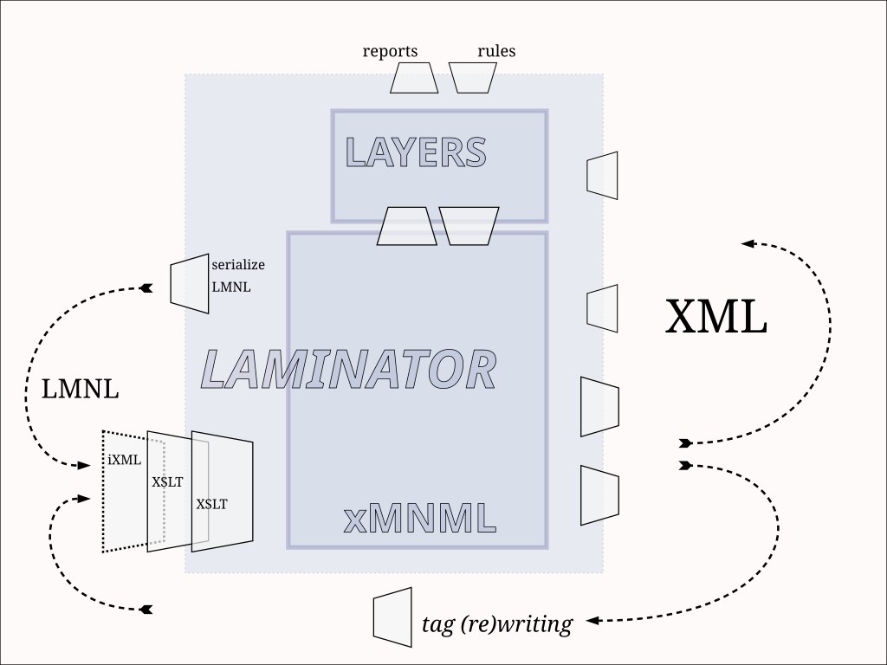

# Laminator design sketch

The Laminator is currently implemented as a set of XProc pipelines, orchestrating logic from a library of XSLT transformations and other encoded sources.

It uses iXML for parsing MNML LMNL inputs. A XProc 3.1 processor with Invisible XML capability is the only requirement for running the pipelines.

The architecture (an illustration)

In the diagram, wedges are XSLT transformations, both generic and tailored:

## Conformance with the models

Each target format for internal operations in the Laminator has a schema that *nominally* defines it. See:

- An RNC [schema for xMNML](../../../lib/xMNML/rules/xMNML.rnc)
- An RNC [schema for LAYERS](../../../lib/LAYERS/rules/MNML-LAYERS.rnc)

These should be useful when developing processing pipelines to provide extra assurances and early debugging.

LONG-TERM GOALS: Wire these into a regression testing framework to guarantee stability; document them more fully (RNG+docs?)

## Using xMNML and LAYERS together

The Laminator parsing tool chain (main pipeline) produces both xMNML and LAYERS by default from a MNML LMNL markup instance. Internally, the LAYERS instance is produced from the xMNML tag model as a secondary result. However, their respective information sets are well defined such that creating the corresponding xMNML from a LAYERS instance is also possible. 

The xMNML model is a "tag sequence model" of the document, while LAYERS is a "range model". xMNML is close to the tags: it provides a *control surface* for (nominal) document tagging, being easily rewritten back into syntax. LAYERS serves as a control surface and interface for working with the document as a set of ranges (or as multiple sets of ranges, when the 'layering' capability of LAYERS is used).

Both formats can be queried to report back properties of the document and its ranges, but in different ways, more or less direct (and hence efficient) given the nature of the query. So each has its strengths for some families of operations.

Each is capable of being converted into other formats (XML and plain text, and from there into HTML, PDF, Markdown etc.). At the same time, some kinds of results are most simply obtained by converting from xMNML into LAYERS first, or the other way around.

When a text file is tagged in MNML LMNL and observes conventions of **normal** tag ordering in the syntax (described in the [MNML Spec](mnml-specification.md)), and avoids (always problematic) congruent ranges, data can be converted between these two formats *losslessly*, such that *round-trip conversion* is possible - a MNML document, described in xMNML, can be converted into a LAYERS instance, and then back into xMNML, with the resulting xMNML being "string-equal" and "identical" to the first rendering.

A MNML LMNL document that is "normal" with respect to tag ordering, and that presents no congruent ranges (which includes adjacent empty ranges), shows **fully defined tag order** in its tagging. While not an essential property of MNML LMNL, this is useful - essentially, tags in LMNL that does not follow this rule can be "slippery", switching order between outputs and inputs of "the same" document. When not unexpected -- or when never seen (maybe a system is not called on to be able to reproduce its inputs) -- this hardly matters. But for purposes of process tracing and validation (for example), often tag order needs to be controlled as well.

(NB: the Laminator also includes a feature for tracing upstream tag placement, which can also be used to mitigate and sometimes solve tag-ordering anomalies, *without* requiring "normally tagged" inputs. See its `@L` and `@ch` attributes.)

Even when lossless conversion is not possible with respect to tag ordering (congruent ranges are given, or a "tag ordering norm" has been violated), results of round-trip conversion between xMNML and LAYERS are predictable and reliably comparable. (At worst, compare the result to a normalized copy of the input).

Cf a [lightweight testing pipeline]( ../../../demo/baselines/TEST_LAYERS_ROUNDTRIP.xpl) for this capability as implemented in the Laminator.

## *Redundant availability* in the models

The internal models are designed *not* to be the most efficient possible for any specific process (such as analysis, rewriting or rendering), or indeed to balance efficiencies, but rather to support applications by providing multiple ways of detecting and determining properties of the document or its ranges, such that they can find their own best and most efficient means, among many available choices. 

This redundancy in the properties of the respective data structures has advantages for both transparency and robustness, making it harder to write application code with silent and hard-to-find bugs.

## What can you do with LMNL and the Laminator?

- Draw pictures and diagrams of the ranges in your data
- Extract the values (only) of ranges of interest
- Convert your overlapping ranges into non-overlapping XML representations
  - then convert into HTML or other formats
- Convert XML with overlaps into 'clean' LMNL
  - support transpositions across XML-based models
- ??? love to hear more ideas

If you are still reading, thanks for your interest in LMNL and the Laminator.

## Methods and approaches

Various methods and approaches are demonstrated both in samples in this repository and in spin-off projects for reading and working with LMNL. Their variety and complementarity is one reason the pipelineing architecture appears to be working.

See the [MNML Specification document](mnml-specification.md) (draft) for more observations on methods and approaches.

-----

